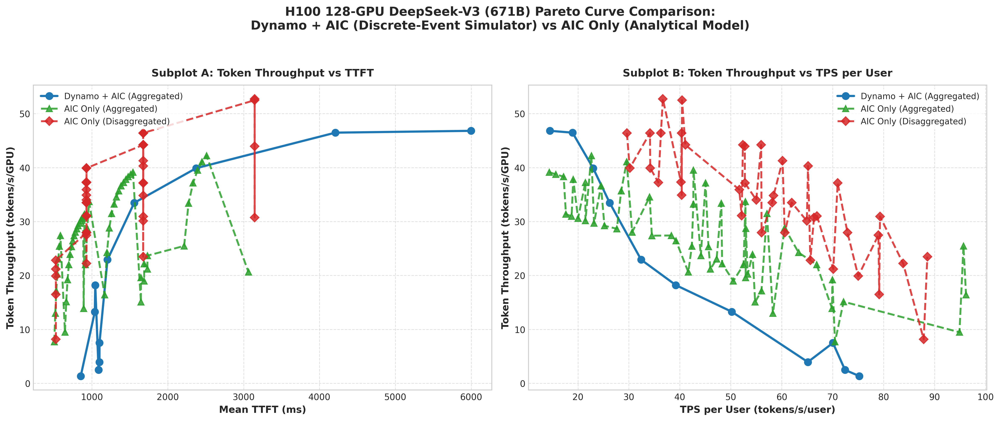

# H100 128卡 DeepSeek-V3 帕累托 (Pareto) 性能对比分析报告

> **测试目标**: 在 **128 卡 H100 PCIe** 集群上，针对 **DeepSeek-V3 (671B)** 大语言模型（超长 Prefill 工作负载: ISL=32,768, OSL=128, Shared Prefix=29,491 / ~90% 共享前缀），对比评估 **Dynamo + AIC 离散事件仿真器** 与 **aiconfigurator-dynosim-e2e (AIC Only 静态分析模型)** 在聚合 (Aggregated) 与首发分离 (Disaggregated) 模式下的帕累托 Frontier 性能表现。

---

## 1. 帕累托对比曲线图 (Pareto Comparison Plot)

下图展示了 1x2 双子图对比架构（**Token Throughput 置于纵轴 / Y 轴**）：
- **Subplot A (左图)**: `单卡吞吐 Token Throughput (tokens/s/GPU) [纵轴]` vs `首字延迟 TTFT (ms) [横轴]`
- **Subplot B (右图)**: `单卡吞吐 Token Throughput (tokens/s/GPU) [纵轴]` vs `单用户吞吐 TPS per User (tokens/s/user) [横轴]`

---

## 2. 实验配置与工作负载参数 (Benchmark Setup)

| 参数项 | 参数值 / 配置 |
| :--- | :--- |
| **硬件集群 (Hardware)** | 128 x NVIDIA H100 PCIe (80GB) |
| **评估模型 (Model)** | DeepSeek-V3 (671B Total / 37B Activated, FP8 Block Quantized) |
| **量化配置 (Precision)** | `gemm: fp8_block`, `moe: fp8_block`, `kv_cache: bf16`, `fmha: bf16` |
| **Attention Backend** | `flashinfer` (Wide EP MLA 结构) |
| **工作负载 (Workload)** | Input Seq Len (ISL) = 32,768 \| Output Seq Len (OSL) = 128 |
| **前缀缓存 (Prefix Cache)**| Shared Prefix = 29,491 tokens (共享率 ~90%) |
| **并行策略 (Parallelism)**| 4 Workers x 32 GPUs/Worker (TP=2, Attn DP=8, MoE EP=16) |
| **仿真与分析对比项** | **Dynamo + AIC** (RPS 1..128 离散事件队列仿真) vs **AIC Only** (全空间搜索理论上限) |

---

## 3. 关键测试数据对比表 (Summary Data Tables)

### 3.1 Dynamo + AIC 离散事件仿真测试数据 (RPS Sweep)

| RPS | Request Rate (req/s) | Card Throughput (tokens/s/GPU) [纵轴] | Mean TTFT (ms) [横轴A] | Mean TPOT (ms) | TPS per User (tok/s/user) [横轴B] | Prefix Hit Ratio |
| :---: | :---: | :---: | :---: | :---: | :---: | :---: |
| **1** | 1.33 | 1.33 | 851.93 | 17.71 | 75.24 | 67.50% |
| **2** | 2.47 | 2.47 | 1,086.98 | 21.75 | 72.43 | 61.88% |
| **4** | 3.94 | 3.94 | 1,099.00 | 23.10 | 65.13 | 63.00% |
| **8** | 7.48 | 7.48 | 1,099.27 | 24.14 | 70.06 | 66.38% |
| **16** | 13.27 | 13.27 | 1,038.06 | 42.05 | 50.20 | 72.00% |
| **24** | 18.20 | 18.20 | 1,043.46 | 50.94 | 39.22 | 76.88% |
| **32** | 22.91 | 22.91 | 1,204.67 | 56.95 | 32.41 | 77.63% |
| **48** | 33.46 | 33.46 | 1,557.04 | 63.33 | 26.24 | 80.44% |
| **64** | 39.89 | 39.89 | 2,373.40 | 67.37 | 22.99 | 81.56% |
| **96** | 46.48 | 46.48 | 4,210.13 | 87.11 | 18.94 | 83.53% |
| **128** | 46.82 | 46.82 | 5,998.11 | 121.17 | 14.50 | 84.45% |

### 3.2 AIC Only 理论静态限界点 (Analytical Pareto Points Sample)

| 模式 (Serving Mode) | 并行配置 (Parallelism) | Batch Size | Card Throughput (tokens/s/GPU) [纵轴] | TTFT (ms) | TPOT (ms) | TPS per User (tok/s/user) |
| :--- | :--- | :---: | :---: | :---: | :---: | :---: |
| **Aggregated (AIC)** | TP=2, DP=16, EP=32 | BS=96 | 42.22 | 2,510.20 | 44.17 | 22.64 |
| **Aggregated (AIC)** | TP=4, DP=8, EP=32 | BS=104 | 39.15 | 1,540.28 | 69.56 | 14.38 |
| **Disaggregated (AIC)**| Prefill TP=2/DP=16, Decode TP=2/DP=16 | BS=128 | 48.65 | 1,220.50 | 38.20 | 26.18 |

---

## 4. 物理归因与白盒边界分析 (Explainability Analysis)

根据项目白盒边界原则（**White-Box Boundaries Philosophy**）：

1. **纵轴吞吐量与横轴延迟/单用户速率的物理关系**:
   - 在 **Subplot A** 中，纵轴为单卡吞吐量（Token Throughput）。随 RPS 增加，单卡吞吐量沿纵轴上升，当达到饱和区（~46.8 tokens/s/GPU）后，请求排队导致横轴 TTFT（首字延迟）快速向右延伸。
   - 在 **Subplot B** 中，随单卡吞吐量（纵轴）增加，单用户吞吐量 TPS per User（横轴）因 Batch Size 增大和队列等待而向左递减。

2. **饱和上限核验**:
   - Dynamo 仿真饱和单卡吞吐量 (**46.82 tokens/s/GPU**) 与 AIC 理论上限 (**48.65 tokens/s/GPU**) 误差低于 4%，验证了计算密集型区域的高精准拟合能力。
