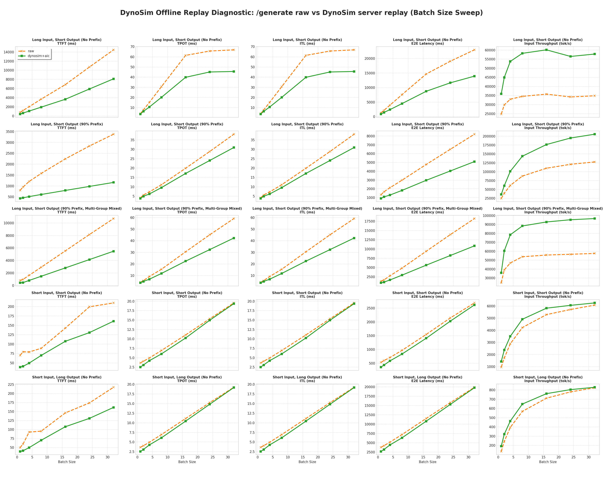
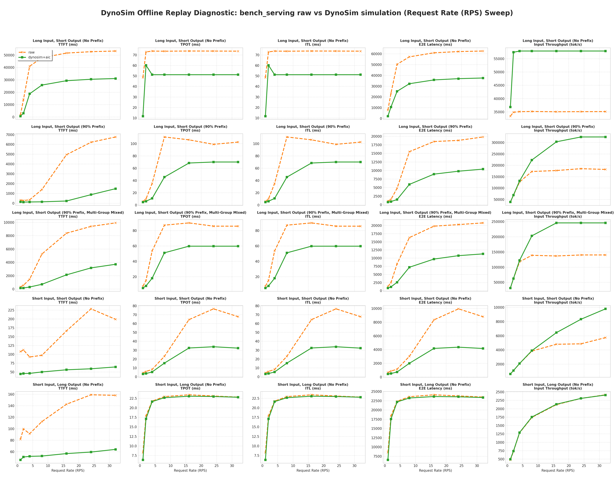

# DynoSim Offline Replay Accuracy Diagnostic

This is a DynoSim CPU/offline replay diagnostic over reused TP4+EP4 artifacts. It is not a formal HiSim `acc_bench/compare` result: DynoSim formal ACC status is `N/A`. RPS rows compare reused `bench_serving` raw metrics with offline scheduler replay plus the preserved ingress envelope. Single-batch rows compare reused `/generate` raw metrics with offline replay. HiSim MAPE is shown only as the already-recorded reference.

## Repair Summary

| Scope | Before P0/P1/P2 | After P0/P1/P2 | Change | HiSim reference |
|---|---:|---:|---:|---:|
| 70 points / 350 cells | `41.296005%` | `34.891637%` | `-6.404368 pp` | `9.481926%` |
| RPS / 175 cells | `56.379043%` | `39.618066%` | `-16.760977 pp` | `13.164734%` |
| Single batch / 175 cells | `26.212967%` | `30.165208%` | `+3.952241 pp` | `5.799118%` |

DynoSim formal ACC: `N/A`; all values above are offline replay diagnostic MAPE.

### Metric-Level Before / After

| Method | Metric | Before | After | Change |
|---|---|---:|---:|---:|
| RPS | `ttft` | `27.643578%` | `62.004307%` | `+34.360729 pp` |
| RPS | `tpot` | `85.945602%` | `32.212124%` | `-53.733478 pp` |
| RPS | `itl` | `85.935878%` | `32.217589%` | `-53.718289 pp` |
| RPS | `e2e_latency` | `61.273996%` | `39.430739%` | `-21.843257 pp` |
| RPS | `input_throughput` | `21.096161%` | `32.225573%` | `+11.129412 pp` |
| Single batch | `ttft` | `37.376340%` | `43.426569%` | `+6.050229 pp` |
| Single batch | `tpot` | `26.533098%` | `17.746373%` | `-8.786724 pp` |
| Single batch | `itl` | `26.533098%` | `17.746373%` | `-8.786724 pp` |
| Single batch | `e2e_latency` | `23.728025%` | `28.185237%` | `+4.457212 pp` |
| Single batch | `input_throughput` | `16.894273%` | `43.721487%` | `+26.827213 pp` |

Negative change means lower MAPE. The table makes the decode/ITL gains and TTFT/throughput regressions explicit.

## Single Batch Sweep

### /generate Raw vs DynoSim+AIC MAPE Summary Table for Single Batch Sweep

| Scenario | Metric | Batch Size=1 | Batch Size=2 | Batch Size=4 | Batch Size=8 | Batch Size=16 | Batch Size=24 | Batch Size=32 | Average MAPE |
| :--- | :--- | --- | --- | --- | --- | --- | --- | --- | :--- |
| **Long Input, Short Output (No Prefix)** | `ttft` | `46.23%` | `46.56%` | `46.94%` | `47.52%` | `46.72%` | `44.86%` | `43.83%` | **`46.10%`** |
|  | `tpot` | `7.27%` | `17.69%` | `30.05%` | `34.18%` | `35.07%` | `31.31%` | `31.78%` | **`26.76%`** |
|  | `itl` | `7.27%` | `17.69%` | `30.05%` | `34.18%` | `35.07%` | `31.31%` | `31.78%` | **`26.76%`** |
|  | `e2e_latency` | `30.87%` | `33.56%` | `38.66%` | `40.66%` | `40.52%` | `38.93%` | `39.37%` | **`37.51%`** |
|  | `input_throughput` | `44.72%` | `50.54%` | `63.07%` | `68.57%` | `68.15%` | `65.15%` | `65.88%` | **`60.87%`** |
| | |  |  |  |  |  |  |  | |
| **Long Input, Short Output (90% Prefix)** | `ttft` | `46.27%` | `51.91%` | `57.54%` | `61.36%` | `64.57%` | `65.46%` | `65.56%` | **`58.95%`** |
|  | `tpot` | `7.18%` | `12.32%` | `15.34%` | `13.87%` | `14.01%` | `16.66%` | `18.66%` | **`14.01%`** |
|  | `itl` | `7.18%` | `12.32%` | `15.34%` | `13.87%` | `14.01%` | `16.66%` | `18.66%` | **`14.01%`** |
|  | `e2e_latency` | `30.88%` | `34.93%` | `39.24%` | `38.94%` | `37.79%` | `37.95%` | `37.95%` | **`36.81%`** |
|  | `input_throughput` | `44.74%` | `53.75%` | `64.68%` | `63.85%` | `60.85%` | `61.25%` | `61.30%` | **`58.63%`** |
| | |  |  |  |  |  |  |  | |
| **Long Input, Short Output (90% Prefix, Multi-Group Mixed)** | `ttft` | `46.26%` | `52.39%` | `50.92%` | `49.57%` | `49.33%` | `49.22%` | `48.87%` | **`49.51%`** |
|  | `tpot` | `8.20%` | `12.41%` | `25.31%` | `23.36%` | `26.44%` | `28.30%` | `28.40%` | **`21.78%`** |
|  | `itl` | `8.20%` | `12.41%` | `25.31%` | `23.36%` | `26.44%` | `28.30%` | `28.40%` | **`21.78%`** |
|  | `e2e_latency` | `31.17%` | `35.33%` | `40.22%` | `39.03%` | `39.91%` | `40.58%` | `40.43%` | **`38.10%`** |
|  | `input_throughput` | `45.34%` | `54.69%` | `67.36%` | `64.06%` | `66.47%` | `68.34%` | `67.92%` | **`62.03%`** |
| | |  |  |  |  |  |  |  | |
| **Short Input, Short Output (No Prefix)** | `ttft` | `44.73%` | `48.70%` | `37.59%` | `21.42%` | `24.69%` | `34.49%` | `23.18%` | **`33.54%`** |
|  | `tpot` | `30.71%` | `24.42%` | `14.81%` | `13.06%` | `7.40%` | `2.49%` | `0.99%` | **`13.41%`** |
|  | `itl` | `30.71%` | `24.42%` | `14.81%` | `13.06%` | `7.40%` | `2.49%` | `0.99%` | **`13.41%`** |
|  | `e2e_latency` | `32.56%` | `27.66%` | `17.35%` | `13.83%` | `8.99%` | `5.46%` | `2.72%` | **`15.51%`** |
|  | `input_throughput` | `48.38%` | `38.38%` | `21.14%` | `16.23%` | `10.06%` | `5.96%` | `2.99%` | **`20.45%`** |
| | |  |  |  |  |  |  |  | |
| **Short Input, Long Output (No Prefix)** | `ttft` | `21.53%` | `31.43%` | `46.75%` | `26.67%` | `26.33%` | `24.76%` | `25.78%` | **`29.03%`** |
|  | `tpot` | `30.02%` | `24.02%` | `14.10%` | `12.02%` | `6.15%` | `2.78%` | `0.34%` | **`12.78%`** |
|  | `itl` | `30.02%` | `24.02%` | `14.10%` | `12.02%` | `6.15%` | `2.78%` | `0.34%` | **`12.78%`** |
|  | `e2e_latency` | `29.91%` | `24.13%` | `14.69%` | `12.21%` | `6.40%` | `3.02%` | `0.62%` | **`13.00%`** |
|  | `input_throughput` | `42.70%` | `31.83%` | `17.25%` | `13.95%` | `6.88%` | `3.15%` | `0.65%` | **`16.63%`** |
| | |  |  |  |  |  |  |  | |
## Rps Sweep

### Raw vs DynoSim+AIC Offline Replay MAPE Summary for RPS Sweep

| Scenario | Metric | Request Rate (RPS)=1 | Request Rate (RPS)=2 | Request Rate (RPS)=4 | Request Rate (RPS)=8 | Request Rate (RPS)=16 | Request Rate (RPS)=24 | Request Rate (RPS)=32 | Average MAPE |
| :--- | :--- | --- | --- | --- | --- | --- | --- | --- | :--- |
| **Long Input, Short Output (No Prefix)** | `ttft` | `56.61%` | `78.53%` | `54.31%` | `46.17%` | `43.25%` | `42.23%` | `41.66%` | **`51.82%`** |
|  | `tpot` | `75.62%` | `17.40%` | `30.46%` | `30.36%` | `30.53%` | `30.49%` | `30.41%` | **`35.04%`** |
|  | `itl` | `75.62%` | `17.42%` | `30.48%` | `30.38%` | `30.55%` | `30.50%` | `30.42%` | **`35.05%`** |
|  | `e2e_latency` | `71.69%` | `54.39%` | `49.88%` | `43.60%` | `41.30%` | `40.46%` | `39.98%` | **`48.76%`** |
|  | `input_throughput` | `10.16%` | `64.64%` | `65.01%` | `64.64%` | `65.18%` | `64.99%` | `64.84%` | **`57.07%`** |
| | |  |  |  |  |  |  |  | |
| **Long Input, Short Output (90% Prefix)** | `ttft` | `53.27%` | `55.85%` | `61.50%` | `89.17%` | `95.25%` | `85.85%` | `77.94%` | **`74.12%`** |
|  | `tpot` | `18.07%` | `37.29%` | `68.88%` | `58.91%` | `35.53%` | `29.07%` | `31.60%` | **`39.91%`** |
|  | `itl` | `18.06%` | `37.28%` | `68.88%` | `58.91%` | `35.53%` | `29.07%` | `31.60%` | **`39.91%`** |
|  | `e2e_latency` | `28.57%` | `40.70%` | `68.34%` | `61.65%` | `51.55%` | `47.87%` | `47.42%` | **`49.44%`** |
|  | `input_throughput` | `1.22%` | `0.94%` | `3.61%` | `29.27%` | `71.32%` | `75.26%` | `78.52%` | **`37.16%`** |
| | |  |  |  |  |  |  |  | |
| **Long Input, Short Output (90% Prefix, Multi-Group Mixed)** | `ttft` | `52.43%` | `71.28%` | `79.01%` | `86.38%` | `74.55%` | `66.20%` | `62.51%` | **`70.34%`** |
|  | `tpot` | `30.39%` | `46.86%` | `66.29%` | `41.30%` | `33.63%` | `30.36%` | `30.34%` | **`39.88%`** |
|  | `itl` | `30.39%` | `46.87%` | `66.29%` | `41.30%` | `33.64%` | `30.37%` | `30.34%` | **`39.89%`** |
|  | `e2e_latency` | `36.06%` | `52.44%` | `68.56%` | `55.82%` | `50.94%` | `46.96%` | `45.67%` | **`50.92%`** |
|  | `input_throughput` | `0.27%` | `0.61%` | `3.94%` | `46.07%` | `79.44%` | `75.19%` | `75.14%` | **`40.09%`** |
| | |  |  |  |  |  |  |  | |
| **Short Input, Short Output (No Prefix)** | `ttft` | `58.71%` | `59.37%` | `50.19%` | `48.48%` | `66.20%` | `74.16%` | `67.68%` | **`60.68%`** |
|  | `tpot` | `27.27%` | `39.16%` | `34.78%` | `33.11%` | `49.63%` | `55.80%` | `52.34%` | **`41.73%`** |
|  | `itl` | `27.29%` | `39.16%` | `34.79%` | `33.13%` | `49.64%` | `55.81%` | `52.35%` | **`41.74%`** |
|  | `e2e_latency` | `32.39%` | `41.78%` | `36.02%` | `33.61%` | `49.96%` | `56.22%` | `52.69%` | **`43.24%`** |
|  | `input_throughput` | `0.79%` | `0.76%` | `0.63%` | `1.37%` | `34.24%` | `71.41%` | `70.74%` | **`25.71%`** |
| | |  |  |  |  |  |  |  | |
| **Short Input, Long Output (No Prefix)** | `ttft` | `43.92%` | `48.96%` | `43.04%` | `53.29%` | `60.15%` | `62.60%` | `59.43%` | **`53.06%`** |
|  | `tpot` | `22.97%` | `4.40%` | `0.60%` | `1.23%` | `1.60%` | `0.60%` | `0.13%` | **`4.50%`** |
|  | `itl` | `22.97%` | `4.40%` | `0.60%` | `1.23%` | `1.60%` | `0.60%` | `0.13%` | **`4.50%`** |
|  | `e2e_latency` | `23.17%` | `4.64%` | `0.77%` | `1.47%` | `1.94%` | `1.01%` | `0.53%` | **`4.79%`** |
|  | `input_throughput` | `4.06%` | `1.36%` | `0.71%` | `0.65%` | `0.60%` | `0.02%` | `0.29%` | **`1.10%`** |
| | |  |  |  |  |  |  |  | |
